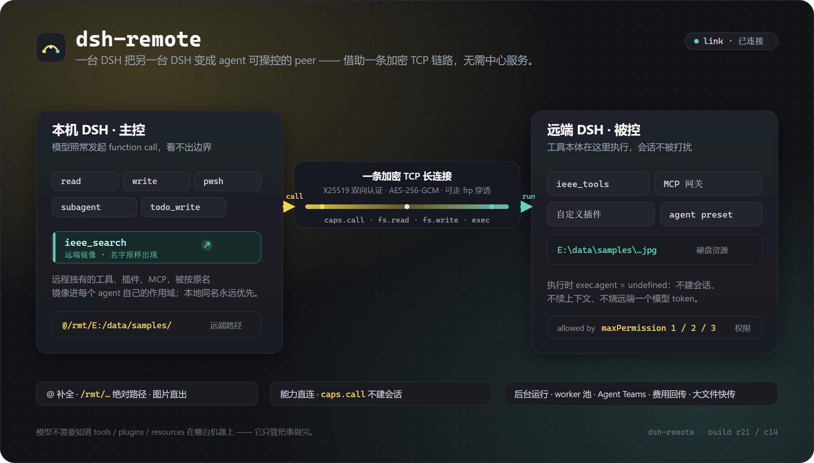
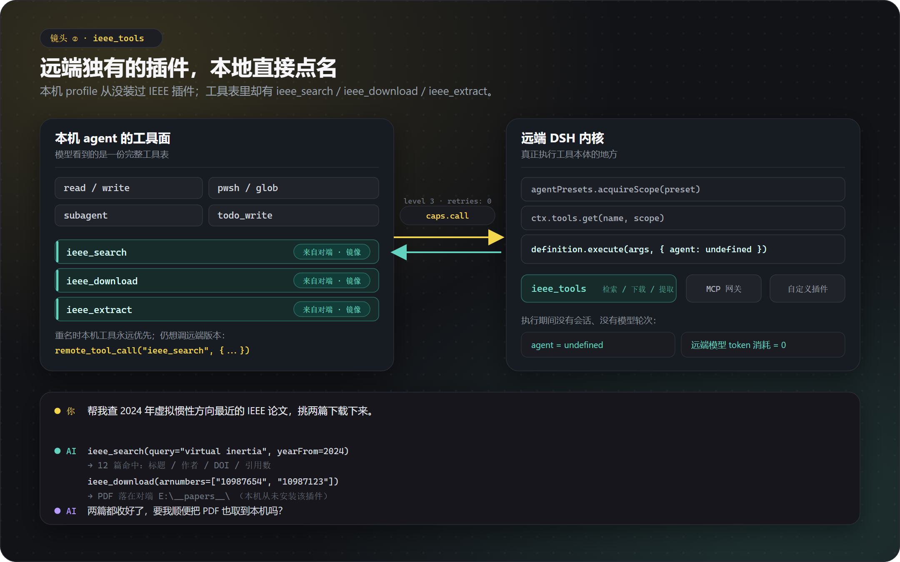
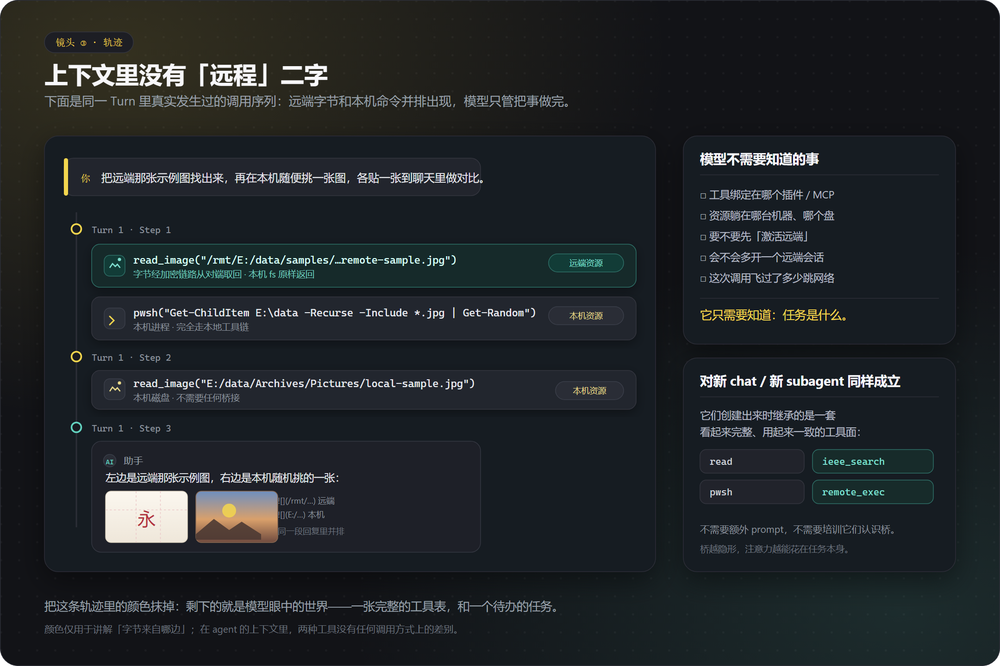

# dsh-remote

> 插件集导航与市场索引：https://github.com/jensentsts/dsh-independent-plugins


> 本仓库版本依赖 DSH 与包清单中声明的 peer dependencies；请以 `package.json` 为准。

> DSH 插件，用于无缝衔接本地和远程主机的 dsh 工作。  
> DSH plugin for using dsh on a remote host like what dsh does on the local host, seamlessly.

`X25519 双向认证 + AES-256-GCM` · `多主机双向直连` · `@主机:插件 / 工作区 / 路径` · `Build r27 / c20` · `License MIT`

## 0.5.2：保留真实多条回复与来源

`agent.prompt` 的新增 `replies` 数组按远端 committed `assistant/message` 顺序保留每条公开回复，包含 `sessionId / seq / messageId / time / turn / step / source / provider / model` 和 durable image/file attachment refs。兼容字符串 `reply` 改为全部公开文本的顺序 join，不再只留最后一句；reasoning、tool blocks、attempt 和 `interrupted:true` 的 partial assistant 不作为回复导出。foreground、问答续接、background status、worker pool 与 remote provider 都携带独立数组。工具的纯 presenter 为每条显示 assistant/model 标签及原始 identity，不依赖 bubble，不向本地主 chat 伪造 assistant 或追加实验插件事件。

**旧 peer 不会因本机升级自动获得多消息。** 新 peer 明确广告 `features.replies=committed-assistant-v1` 并在回复携带同值 `replyFormat`；没有数组的旧 peer 显示 `legacy reply (message boundaries unavailable)`，只保它实际返回的字符串，不能恢复它已经丢掉的早期消息，也不能靠切句子或伪造 messageId 宣称已支持。attachment id 属于远端 Session 的附件库；本版本保留引用但不自动跨机下载或冒充本地可渲染附件，media-only 回复仍可在工具结果中看到引用。

新增输入默认使用合法 producer `MessageSource.kind:dsh-remote`（仍是 user role，不代表本地真人）；启用可选 `superAgentIo` 时改由 IO 的 `super-agent-io` source 准入。持久 `dsh_remote_message_traces` storageDomain v1 保存 transport admission facts，锚定 principal + 本地 scoped sessionId + committed seq + messageId。必须在唤醒 Agent 前落 admission intent；缺 storageDomain/写失败拒绝输入，接收是否发生不明确则不自动重放。sidecar 缺失表示来源未知，不改历史、不写 provider replayState，也不参与普通 Session replay。该输入路径需要官方 storageDomain 服务及 zod peer；client 连接、文件与加密层不依赖 Super agent IO。

`agent.note(mode?)` 新增 `queue / steer / auto`：queue 使用 followup 下一轮，steer 使用下一已准入 step，默认 auto 忙时 steer、闲时 queue；返回实际 `mode / processing`，steer 不等同取消已经准备的请求。只有广告 `features.noteModes` 的升级 peer 才能保证显式 steering；旧 peer 的默认/queue 明示 followup 降级，显式 steer 拒绝而非悄悄排下一轮。冷 resume 仅 exact `SessionPersistenceNotFoundError` 的同一 sessionId（或官方 exact session/not-found）可 create；corrupt、writer-held、unsupported、generic IO 等错误原样失败。remote scoped preset/model/setup 生命周期保留，普通 sessionController.resolveAgent 无 setup 入口，不能无损替换它。

**可选 Super agent IO v1 对接**（server 配置 `superAgentIo: true`，默认关）：受控端的 controller 输入改由公开 `superAgentIo.receive` 准入，Session 行保留 IO 的真实外部 producer source（不冒充本机真人）；IO 路由的每个 committed `assistant/message` 各走一次 `transport.deliver`，client 以 `assistant.reply` 帧逐条接收，并只在最终 committed `replies` 数组上按 `sessionId + messageId` 补缺，不切句、不合成 assistant。IO 服务缺失、开关关闭、绑定不可用或明确的 pre-send 拒绝时自动回到原 `dsh-remote` 路径；`unknown` 准入绝不回退重发。IO 自己的 `enabled` / `sendEnabled` 门仍然生效，bubble 与 IO 都不是加载前提。

client 侧另有默认关闭的 `superAgentIoInbound`：`agent.note` 等异步回复在没有等待中的 RPC 时，按认证主机及其会话前缀精确匹配已映射的本机会话，经 IO `receive` 进入本地队列。稳定外部消息 ID 由主机、会话和消息组成；结构化 `replySource` 保存真实主机、模型和消息坐标，正文保留原文，媒体显示为远端引用。该外部输入可触发一次本地模型调用。绑定使用 `receiveOnly:true`、`sendEnabled:false`，本地回复留在会话内。RPC 和异步入口共享去重，缺 IO 或关闭开关时保留原 RPC 和缓冲路径。

验证与构建见 [0.5.2 离线验证记录](docs/MESSAGES-0.5.2.md)。原作者、仓库与 MIT 许可保持不变；这份独立源码尚未安装到 live profile，未对真实 peer 外发。

## 0.5：单入口中心式互联

新增可选中心字节转发和主动接入节点：所有设备可通过同一个现有 FRP/VPN TCP 入口连接中心，无需每台设备新增公网隧道。设备之间仍使用既有端到端双向认证和独立权限，中心只转发、不代授权；默认关闭，逐设备显式 pair ACL。详见 [中心式互联指南](docs/MESH.md)。当前交付 Node.js/Cordis 代理，不等于已提供原生手机或浏览器客户端。

## 0.4：通信与跨端鉴权加固

默认禁止自动降级到旧握手；新增有界连接/握手预算、整帧超时与背压、完整 SHA256 指纹、身份授权的禁用/期限/精确操作白名单，以及实时撤销和密钥轮换检查。level 1/2 文件读取现在必须显式配置 `readRoots`，避免只读主机读取整机凭据。**这是安全默认值的兼容性变化**，升级前请查看 [安全与迁移指南](docs/SECURITY.md)。未更改既有 DSHR2 密码套件。

## 0.3：多主机与命名资源

每台 DSH 都可以同时启用 client 和 server，连接多台已固定公钥的主机。设置页支持添加/删除主机、选择默认主机和入站授权；出站权限、入站身份、取消和问答按主机隔离。不会自动发现或信任网络中的其他机器。

```text
@studio:clock                        # 插件检索
@studio:/C:/data/report.txt           # 远程绝对路径
@studio:产品/docs/brief.md            # 远端 DSH 命名工作区
@"studio:设计 笔记/docs/brief.md"       # 空格使用引号
@产品/docs/brief.md                   # 本地，独立 dsh-workspace-reference 插件
```

**不引入 `~`。** 同名工作区或同名插件不猜测，提供明确的 `主机:workspace:ID` / `主机:plugin:包名` 和 `remote_references` 带类型检索；目录候选绑定绝对目标。完整语法、双向配置、旧版兼容与安全边界见 [多主机指南](docs/MULTI-HOST.md)。以下旧单机用法仍兼容。

想象这样一个场景：你坐在书房的主力机前，屏幕里开着熟悉的 DeepSeek Harness（DSH）；而在另一间屋子、另一个城市，甚至几层 NAT 与防火墙背后，躺着另一台机器——那里有它独有的显卡、散落在 `E:\` 盘里的陈年素材、配好的编译环境，以及另一个正在静静运行的 DSH。

过去你要跨越这道鸿沟，往往得切出终端敲 SSH、来回搬运报错日志，或者在远端挂一个只会机械跑 shell 的简陋脚本。装上 **`dsh-remote`** 之后，事情变了：**你眼前的这台 DSH，直接坐上了远端那台 DSH 的「用户席」**。它可以像真人一样向对端 agent 布置任务、等对端思考与调用工具跑完一整轮、再把干干净净的交付带回本机对话；也可以顺着同一条管道在对端跑命令、流式搬运几百兆的大文件、把远端独有的插件工具原名「借」来直接 function call，甚至把远端硬盘挂成 `/rmt/E:/…` 路径——让你在输入框敲 `@` 补全远端目录，在聊天框里用一句 `` 直接渲染远端图片。

连接两座孤岛的，仅仅是**一条 TCP 长连接**（藏在 `frp`、Tailscale 或局域网后面即可穿透 NAT）：**X25519 双向静态密钥认证 + 临时密钥前向保密 + AES-256-GCM 逐帧加密 + 严格递增计数器抗重放**。全仓库只用 Node.js 内置模块，**零外部依赖**。



<sub>示意图：左边是本机模型看到的完整工具面，右边是真正执行工具本体的对端内核；桥在中间，模型看不见它。</sub>

---

## 为什么是「一对插件」

在动手写第一行代码之前，最容易想到的其实是偷懒方案：在远端跑一个几十行的独立 Python 代理不就行了吗？或者干脆用 DSH 创造模式的动态插件（`cordis_define`）现场捏一个？

真撞上去就会发现两条路都是死胡同：独立裸进程摸不到 DSH 的「大脑」——它能调起 `powershell.exe`，却拿不到 `agents`、`sessions`、`agentPresets` 和 `workspaceRegistry`，没法真正唤醒和续接一段会话，更没法让远端界面侧边栏看见这段对话；而动态插件按官方契约天生是进程内、临时性的（temporary and process-local），DSH 一重启监听器就灰飞烟灭。

于是 `dsh-remote` 把自己拆成了咬合在一起的**一对静态 Cordis 插件**，隔着加密隧道遥相呼应：

```
        主控机 (client 端)                        被控机 (server 端)
   ┌───────────────────────┐                 ┌───────────────────────┐
   │  DSH                  │                 │  DSH                  │
   │   └ src/client.ts     │  ── TCP ──►     │   └ src/server.ts     │
   │     注册 remote_* 工具 │  已认证加密通道  │     监听本地回环端口    │
   │     镜像远端独有工具   │  (按 id 多路复用)│     ├ 执行命令/流式传文件│
   │  本机 agent 调用工具 ──┼─────────────────┼─►   └ 注入服务驱动 agent│
   └───────────────────────┘                 └───────────────────────┘
```

- **主控端（`src/client.ts`）** 站在你手边：负责懒拨号（第一次用工具才连，断线仅对明确列出的观察性读取自动重试）、按请求 `id` 多路复用同一条加密流，并向本机模型交出一整套 `remote_*` 工具、subagent 委派入口与远端能力镜像。
- **被控端（`src/server.ts`）** 守在远方：默认只绑定 `127.0.0.1` 的回环端口，把公网入口留给隧道；因为它本身就是对端 DSH 里的真插件，注入了 `agents` / `sessions` / `agentPresets` / `agentDefaultModel` / `workspaceRegistry`，所以它**不是在门外敲窗户，而是直接握着对端会话的方向盘**。

---

## 快速开始

从两台互不相识的机器到第一次跨机对话，只需要四步。

### 1. 铸造钥匙对

```bash
python tools/gen-keys.py
```

脚本只用 Python 标准库，会在 `keys/active/` 下按角色分好两套钥匙，顺手装进本机默认的 `$DSH_HOME/dsh-remote/`，并在终端打印出两侧公钥的 SHA-256 指纹（0.4 脚本与插件均显示 `SHA256:` 加完整 64 位十六进制，核验以完整指纹为准）供你核对。这里没有中心化 CA，也没有密码口令——**谁持有配对私钥并被对方 pin 住公钥，谁才是合法对端**。

### 2. 唤醒被控机（server 端）

把 `keys/active/server-side/` 里的 `server.key` 与 `client.pub` 放进被控机的 `$DSH_HOME/dsh-remote/`，然后在该机 profile 的 `cordis.patch.yml` 末尾挂上受控端（推荐走预编译 bundle，也支持直接指到源码）：

```yaml
- insert:
    - id: dsh-remote-server
      name: 'file:///C:/path/to/dsh-remote/src/server.ts'
      config:
        host: '127.0.0.1'
        port: 11325          # 必须等于隧道里填的"本地端口"，且由本插件独占
```

### 3. 连上主控机（client 端）

把另一半钥匙 `keys/active/client-side/`（`client.key` + `server.pub`）放进主控机的 `$DSH_HOME/dsh-remote/`，在主控机的 `cordis.patch.yml` 追加：

```yaml
- insert:
    - id: dsh-remote-client
      name: 'file:///C:/path/to/dsh-remote/src/client.ts'
      config:
        host: 'tunnel.example.com'   # 隧道给的公网地址 / Tailscale 名 / 局域网 IP；无默认值，必须显式填
        port: 10000                  # 对应端口
```

重启两边的 `dsh web`（或桌面端）。打包形态安装、受控机配置面板挂载与完整排障表见 [`docs/GUIDE.md`](docs/GUIDE.md)；如果你面对的是一台远在天边、无法物理接触的被控机，升级前请先看 [`docs/DEPLOY-PEER.md`](docs/DEPLOY-PEER.md)。

### 4. 说出第一句话——以及「一麦到底」的规矩

```
remote_agent_prompt  session_id="work-1" preset_id="cordis"
                     workspace="E:\project"
                     text="先读一下这个目录，然后告诉我它是干什么的"
```

`preset_id` 与 `workspace` **只在会话第一次诞生时落定**；往后用同一个 `session_id` 追问，远端就会顺着刚才的记忆往下聊。

而在真实日常里，你甚至**不该手传 `session_id`**。早期版本在省略 `session_id` 时每次都会捏一个带时间戳的新名字，结果几轮下来，远端侧边栏堆满了一次性的孤儿会话，而且每句话都像初次见面一样失忆。现在的铁律是**「一个本机 chat 严格对应一段远端对话」**：

- 省略 `session_id` 时，插件用本机 chat id 算出确定性锚点（`remote-<sha256前12位>`）——同一个窗口每次都精准续接它自己的那一段，哪怕中途换了 `workspace` 或 `preset` 参数也不会把对话劈成两半；对端已有就续接，没有才建一次。
- 工具返回头会坦白交代这次是 `(reused: …)` 还是 `(created)`。只有人类明确说「另起一摊」时，才传 `new_session=true`（多开能力还在，但绝不是默认动作）。
- 这条契约被同时写进了**两侧**的系统提示：本机模型知道「远端是你的一个 subagent / task，本机能干的本机优先，非必要不开新会话」；对端被驱动的会话也清楚「你正被远端当作 task 驱动，交付要自成一体，且屏幕前随时可能有真人插话或按停」。

**打断与提问都是双向贯通的**：
- 你在本机按下 Stop，插件不会粗暴掐断 TCP 了事，而是走对端自己的插件接口发 `agent.interrupt` 让远端体面收尾（若对端恰好还没跑起来，r17+ 还会挂上 30 秒停止闩存，确保那一轮干脆不启动）；
- 反过来，如果远端电脑前坐着真人，他在那边按了停止或插了一句话，被控端会识别出 Web 界面的消息标记并主动推回 `interrupt` / `note` 帧——本机 agent 会当场刹住车、把决定权交回人类，绝不傻等一个永远不会来的回复，也不会擅自重试；
- 要是远端 agent 干活途中拿不定主意调了 `ask_user_question`，问题会被拦截并跨过隧道递回主控端（`pendingQuestion`），由本机审查或转问用户后，用 `remote_answer_question` 把答案喂回那个还挂在半空的远端轮次。

---

## 工具全景

主控端一共向模型交出这组各司其职的工具——从驱动对话、回答反问、翻看零成本轨迹，到跑进程、搬大文件、调度机器池与直调远端内核：

| 工具 | 作用 |
|---|---|
| `remote_agent_prompt` | **核心**：把一段用户发言交给对端 agent，等这一轮跑完取回回复。省略 `session_id` 时**严格复用本 chat 专属对话**（`new_session=true` 可强制新开） |
| `remote_answer_question` | **答复反问**：当对端 agent 轮次中途调用 `ask_user_question` 挂起等待时，把答案按 `question_id` 送回对端并继续等完整回复落地 |
| `remote_agent_ensure` | 提前在对端建好或续接一个会话，但先引而不发（可指定 `preset_id` / `workspace`） |
| `remote_agent_events` | 读取对端活动会话的事件流（只摘消息文本、工具调用与结束原因等干净字段），用于上下文取回、本机压缩与再投递 |
| `remote_journal` | 翻看**远端执行轨迹**：对端每次操作、被驱动轮次、模型调用与真人打断在发生瞬间直接落盘，**零模型调用开销**；按本机 chat 记游标，默认只取上次读过之后的新条目 |
| `remote_agent_interrupt` | 点名打断对端某会话正在跑的那一轮（对端空闲时诚实回报并挂停止闩存） |
| `remote_preset_list` | 列出对端安装的 agent preset（比如确认「创造模式」`cordis` 的 id） |
| `remote_exec` | 在对端跑 PowerShell / cmd（原始字节按 UTF-8 → GBK → Big5 等多编码回退解码，原生命令中文不乱码）；**本地按停时对端进程树一起杀掉**（`exec.cancel`，需对端 r13+） |
| `remote_fs_list` / `remote_fs_write` | 列远端目录 / 写文本文件（自动建父目录）；写入内容 ≥ 512 KiB 且对端 r19+ 时自动切入分块压缩快路径 |
| `remote_put_file` / `remote_get_file` | **流式搬大文件**：本机文件 ⇄ 远端文件直接走加密链路互传，一次工具调用、**字节完全不经过模型上下文**；r19+ 走分块 + 逐块 gzip + 双端 sha256 + 临时文件原子 `rename`，旧对端自动回退单帧/分页 |
| `remote_run_start` / `remote_run_status` / `remote_run_cancel` / `remote_send_message` | **后台运行控制面**：像官方 subagent 一样把长任务丢到远端后台跑（立即拿回 `runId`），不卡住当前轮次；事后取交付、往收件箱追加指示、或中途叫停 |
| `remote_workers` / `remote_worker_prompt` / `remote_pool_dispatch` / `remote_team_dispatch` | **多 worker 机器池 + Agent Teams**：盘点已声明 peer、点名一台干活、同一任务并行派给多台并汇总战报；`remote_team_dispatch` 还会把任务自动记上 **Agent Teams** 共享看板 |
| `remote_capabilities` | **远端能力目录**：只借用 preset scope、**不建任何会话**，列出对端某 preset 可直调的工具（含 JSON Schema）、插件清单、preset、subagent provider 与只读活跃会话 |
| `remote_tool_call` | **按名跨机直调**：绕过远端对话与模型轮次，直接执行对端某个已注册工具的本体；专治本机同名工具遮挡或未镜像的场景 |
| `remote_ping` | 链路听诊器：一行看清本侧与对端的版本、`build` 标记（如 `r21` / `c14`）、主机名、公钥指纹、费用回传状态，以及**本 chat 绑定的远端会话 id** |

> **开箱即 subagent**：插件默认开启 `subagentProvider`（面板里可热开关，改完即时生效，无需手改 composition），把对端注册成 DSH 的 **subagent provider** `remote` 并自带委派工具 `subagent_remote`。于是本地聊天界面会把整块远端委派规整地按 subagent 分组，点本地 Stop 也会顺着 `dispose()` 自动发 `agent.interrupt`。它的边界（one-shot 委派、不在 `list_agents` 里、不可像本地子会话那样点开；若想要 `subagent-N` 后台任务行才需与官方 `@deepseek-ai/dsh-tool-subagent` 行二选一）详见 [`docs/GUIDE.md`](docs/GUIDE.md) §4.5。

---

## 算清远端每一分钱：费用回传（兼容本机 `dsh-cost-meter`）

跨机器干活有个容易让人心里没底的地方：远端每一轮烧掉的是**对端账户**的 token，你本机就算装了 `dsh-cost-meter`，账本上也一片空白。

怎么把这笔账接回来，同时绝不把 `cost-meter` 搞崩？翻遍 `cost-meter` 源码后，答案很清楚：不能去硬改它的私有账本（会撞上三向合并锁），也不该在对端算好美元再传回来（DeepSeek 有峰谷电价与长上下文阶梯，价表一变难道还要重发被控端？）。最干净的做法是：**对端只报原始五桶 token，本机走 `cost-meter` 唯一官方支持的第三方入口** `${DSH_HOME}/storages/cost-meter/external_usage.json`（`records` 逐笔记录模式）。

每当远端一轮尘埃落定，一条静默的记账流水线就会在后台跑起来（全程 best-effort，哪怕网络抖动也只记一行 debug 日志，绝不拖累工具返回）：

```
远端一轮结束 → 本机发只读 usage.read（按会话 nextSeq 游标增量拉取，同构折叠流式重复上报）
             → 落盘持久化 ${DSH_HOME}/dsh-remote/client-cost.json（游标 + 调用记录，≤2000 条）
             → 原子重写 external_usage.json（临时文件 + rename，完整保留其他生产者的 source）
```

随后 `cost-meter` 用**本机最新价表**按每条调用发生的精确 `at` 时刻计价，在「设置 → 费用 → 外部用量」里亮出 `remote/<peerName>` 一栏，并自动汇入**今日 / 本月 / 累计合计**与官方余额对账。

- **账本口径诚实分明**：聊天气泡旁的单会话徽章仍代表本机 DSH 账本，远端开销归入「外部用量 / 合计」——这是 `cost-meter` 的官方契约（它不设第三方单会话注入接口）。
- **天然幂等不重算**：每笔记录的唯一键是 `<远端会话 id>:<seq>`，快照整份原子替换；就算你把本地游标文件删了从零重拉，也绝不会算双份钱。
- **Fail-closed 安全阀**：已知本地推理渠道（`ollama`、`lmstudio`、`vllm` 等）在写入前就会自动滤掉；但若远端用了本机价表不认识的冷门渠道，`cost-meter` 会按契约整份忽略快照——此时先在 `cost-meter` 补上自定义单价，或临时把 `costReporting` 设为 `false`。
- **一眼验活**：跑一次 `remote_ping` 看 `remoteCost`（`enabled` / `source` / `records` / `lastAt`），或去设置页看「外部用量」。需 `costReporting: true`（默认开）且对端为 r18+；老版本对端会自动静默跳过。

完整字段映射与排错指南见 [`docs/GUIDE.md`](docs/GUIDE.md) §4.7 与 §5。

---

## 把窄隧道跑满：大文件传输（分块 + 压缩 + 流水线）

故事来到一条真实的 `frp` 公网隧道前：带宽只有约 2.6 Mbit/s，往返延迟 RTT 约 78 ms。早期版本传文件简单粗暴——把整个文件塞进**一个** base64 JSON 帧里发过去。结果传一个 8 MiB 的文件要苦等 40 到 100 秒：base64 凭空让体积膨胀三分之一，单帧巨无霸堵死流水线、撑高内存，稍有风吹草动就整帧超时。

先拿探针量清瓶颈（见 `tools/bench-probe.mjs`），r19+ 对端给出了真正的快车道：

```
上传  fs.put.begin → 并行 4 路 fs.put.chunk(逐块 gzip) → fs.put.commit（sha256 校验 + 原子 rename）
下载  fs.stat      → 并行 4 路 fs.get(逐块 gzip)       → 写本地临时文件 → fs.hash 校验 → rename
```

在**同一条真实 `frp` 隧道上搬运 8 MiB 文件**的前后实测对比（写 / 读）：

| 载荷形状 | 旧单帧路径 (MiB/s) | 分块快路径 (MiB/s) | 背后发生了什么 |
|---|---|---|---|
| 随机字节（不可压缩） | 0.17 / 0.42 | **0.42 / 0.42** | 写提速 **~2.5×**（消掉巨帧卡顿 + 并行填满管道）；读触及带宽与 base64 物理上限 |
| 源码类文本（约 2× 可压） | 0.44 / 0.41 | **0.84 / 0.86** | 稳定 **~2×**，压缩省下的字节直接兑换成吞吐 |
| 高重复文本 / 全零块 | 0.25 / 0.42 · 0.08 / 0.43 | **21 / 22 · 21 / 24** | 压缩比原地起飞（**50–270×**） |

这套快路径的脾气非常稳健：
- **聪明压缩，绝不倒贴 CPU**：每块默认 1 MiB，先试压 gzip，**只有体积缩到 95% 以下才发压缩块**，遇到已经压过的压缩包或随机二进制自动退回 `raw`；解压端锁死 `maxOutputLength` 精确防 zip bomb。
- **无感能力协商**：只有当对端 `sysinfo.ops` 亮齐全部 5 个新 op 时才启用；连上旧端后仍可协商旧传输操作；pre-selector 旧握手另需显式开启兼容，0.4 不再自动降级。
- **绝不把目标文件写成半成品**：双端全程核对 `sha256`；无论服务端接收还是客户端落盘，都先写目标同目录的临时文件，哈希严丝合缝才原子 `rename` 覆盖。万一 `commit` 回包在半路丢了（结果未知），客户端会明确报错提醒先核验，**绝不自作聪明退回旧路径覆盖**。
- **有兜底、有护栏**：单块网络闪断自动重试 2 次（块按 `index * chunkSize` 幂等落位，不怕乱序和重复）；本机按停立刻发 `fs.put.abort` 清场；服务端守着并发上限（默认 8）、闲置 10 分钟 TTL 与单文件 1 GiB 硬上限。
- **按实测卡准阈值**：内容 **≥ 512 KiB**（`transferFastPathBytes`）才上快车道；更小的碎文件单帧 `fs.write` 只需 1 个 RTT，反而更利索。
- **零上下文税**：`remote_put_file` / `remote_get_file` 只收两侧路径，几百兆字节在底层流式穿梭，一滴都不会溅进大模型的 token 窗口。
- **留白的边界**：不做跨次断点续传、不做目录递归同步；帧外层仍是 JSON 字符串承载 base64（比纯二进制多约 33% 膨胀）。

完整压测口径、全部微调旋钮与排查表见 [`docs/GUIDE.md`](docs/GUIDE.md) §4.8。

---

## 分身、集群与团队：后台运行 · worker 池 · Agent Teams

当远端要跑长达十分钟的全量编译，或者你手头不止一台远端机器时，「发一句、干等一轮」就不够用了。插件在不改动任何上游代码的前提下，搭起了三层调度控制面。

### 后台运行（对齐官方 subagent 语义）

```
remote_run_start(description, text)        → 扭头就回 runId；远端在后台默默跑这一轮
remote_run_status(run_id?, wait_ms?)       → 查进度 / 领交付；省略 run_id 纵览最近运行
remote_send_message(run_id=…, message)     → 往正在跑的远端收件箱塞补充指示（不阻塞）
remote_run_cancel(run_id)                  → 紧急叫停（走对端 agent.interrupt）
```

- **结果按需领取，不挤占本轮上下文**：后台跑完不会突然往当前对话塞一大坨文本，由模型调用 `remote_run_status`（可带 `wait_ms` 阻塞等待最长 10 分钟）主动取回。
- **中途递纸条**：对端 r20+ 支持 `agent.note`，`remote_send_message` 会把新指示直接投进远端会话收件箱而不阻塞等待；旧对端自动退回排队 `agent.prompt`。
- **体面受控**：轮次内的提问与打断照常转发；本机按 Stop 会把运行标为 `cancelling` 并通知对端中断。并发上限由 `maxBackgroundRuns`（默认 8）把关；`backgroundRuns: false` 可整组卸下这 4 个工具（工具表在加载期固定，改后重启生效）。
- **与 `subagent_remote` 的默契分工**：值得当场等结果、希望交付直接呈现在本轮对话里的整块子任务，交给 `subagent_remote`；耗时长、想腾出手先干别的，交给 `remote_run_start`。两者敲的依然是同一个本机 chat 绑定的那段远端会话。

### 多 worker 机器池

如果你在 `dsh-remote-client` 的 `peers` 里声明了好几台远端主机（只配单台 `host`/`port` 也同样兼容），你就拥有了一支随叫随到的跨机小队：

```
remote_workers                        → 点兵：列出所有已声明 peer、连通性、权限上限与本 chat 专属会话
remote_worker_prompt(peer, text)      → 单点派活：指定某一台前台干活并等它交付
remote_pool_dispatch(prompt, peers?)  → 齐射聚合：同一任务并行派给多台（≤8），等全员结算后汇总战报
```

每台 peer 都分到一段由 `peer 名 + 本机 chat id` 共同锚定的确定性会话，反复派活各自续接、绝不串台；`remote_pool_dispatch` 采用单台故障隔离——某台机器掉线或报错只记在它自己的结果行里，绝不拖垮其他正在冲锋的机器；一旦本机按下取消，所有在途 worker 会同时收到 `agent.interrupt`。

### Agent Teams 共享任务板集成

当你身处 **Agent Teams** 团队会话中时，`remote_team_dispatch(description, prompt, peer?)` 会把远端差事正式写进队内看板：**建任务（加 `远端: ` 前缀）→ 认领（claim）→ 远端前台执行 → CAS 写回结果摘要 → 标为完成（complete）**，最后交回 `taskId` 供 `team_task_get` 随时查验。若当前不在 Team 会话里，它会干脆利落地当场报错，绝不静默退化成普通派发让你白花一轮远端 token。

> **诚实说明上游边界**：DSH 的 `spawn_teammate` 只能在**本机进程内**孵化队友，因此远端 peer 并不在 Agent Teams 的正式花名册（roster）里。看板上的任务 owner 始终是发起调用的本机成员（Lead 或某个 teammate），远端机器扮演的是「挂在该成员名下的外部执行力」。如果你想让某台远端机器在团队里拥有像独立队友一样的交互感，最顺手的阵型是：由 Lead `spawn_teammate` 一名本机队友，再让这名队友用 `remote_pool_dispatch` / `remote_worker_prompt` 专职统领远端机器。

完整说明与配置见 [`docs/GUIDE.md`](docs/GUIDE.md) §4.9。

---

## 能力直连：把远端插件当本地插件直接调

试想远端机器上装了一个连接内网数据库的 MCP，或者挂了几个专门控制硬件的自定义插件。如果本机每次只想调一下那个函数，难道非得大动干戈唤醒远端大模型跑上一整轮对话吗？

从 **r21 / c14** 起，不用了。本机会向对端索取一份预设作用域的能力目录（`caps.list`），把对端可调用的工具**用一模一样的远端原名（零前缀、零额外描述开销）镜像进本机 agent**。模型像调本地函数一样发起一次普通的 function call，请求便顺着加密链路直达对端内核、原地跑完那个工具的本体代码：

```
本机模型发起 function call（远端能力目录里的独有工具名）
        ↓ 在该 agent 自己的工具表里直接命中同名镜像
dsh-remote-client  caps.call  ──加密链路──▶  dsh-remote-server
                                              └ agentPresets.acquireScope(preset)
                                                ctx.tools.get(name, presetScope)
                                                definition.execute(args, { agent: undefined, signal })
        ◀──────────── 渲染好的 content ──────
```

为了让这种「跨机借能力」既丝滑又绝不惹祸，底层立下了**三条铁律**：

1. **绝不偷偷建会话，零远端模型消耗。** 一次 `caps.call` 就是纯粹的函数执行：对端只临时借用 preset scope，`exec.agent` 明确为 `undefined`——不建会话、不续上下文、不花对端半个 token（`probe-caps.mts` 甚至专门断言调用前后对端会话集合分毫不差）。那些强依赖活会话的工具（如 `subagent`、`todo_write`、`present`、`goal`）会按它们自己的脾气直接报错，而不会越俎代庖替你开对话。想跟对端聊任务，请继续走 `remote_agent_prompt`。
2. **镜像只装进每个 agent 自己的作用域，绝不染指全局层。** 这里藏着一次真实的血泪教训：c13 曾把镜像注册进本机全局层，结果远端镜像来的 `load_workspace_dependencies` 抢先占了坑，把晚一步加载的本机官方插件当场撞崩。c14 彻底改写为按 `agent.ctx` 逐个安装——装之前先扫一遍该 agent 已经能看到的全部工具（host 级 + 自身 preset），**凡是重名一律礼貌跳过**。于是本机原生工具永远优先、不可能与任何插件抢全局名字；只有远端**独有**的绝活才会严丝合缝地「补」进你的工具栏。万一你偏要调用那个被本机同名工具遮住的远端版本？点名调 `remote_tool_call(name, arguments)` 即可。
3. **生杀大权永远握在对端内核手里。** 目录里标为 `callable: false` 的工具一律禁调：包括本插件自己的 `remote_*` / `remote__*` 桥接工具（严防主控套主控的俄罗斯套娃）、需要真人在远端屏幕前点弹窗的交互工具（`ask_user_question`、`exit_plan_mode`、`present`），以及被对端 `deniedTools` 拉黑的名字。因为直调等同于在对端执行能力，`caps.call` 与 `caps.cancel` 要求最高权限等级 **level 3**，且传输层强制 `retries: 0`（绝不因回包丢失而把非幂等动作重放两遍）。

- **随时翻看与热同步**：`remote_capabilities` 可查看工具 schema、插件清单、preset、subagent provider 与对端只读活跃会话（传 `preset_id` 可看其他预设，传 `tool` 单看某工具完整 JSON Schema）；远端插件增删时对端会主动推送 `caps.changed` 让本机无感热更新镜像，外加 `capabilityRefreshSeconds`（默认 300 秒）兜底轮询。
- **向下兼容**：旧版对端没有 `caps.list` 时，本机只记一行日志、安静收起镜像，绝不报错打扰。

详细配置见 [`docs/GUIDE.md`](docs/GUIDE.md) §4.10 与 §5。

---

## 像逛本地硬盘一样用远端文件：远程路径（`/rmt/…`）

工具箱再丰富，人在聊天框里最自然的本能依然是敲一个 `@` 挑文件，模型最顺手的肌肉记忆依然是 `read` / `write` / `edit` / `read_image`，而展示远端成果最直观的方式莫过于在回复里直接写一行 Markdown 图片。

启用联邦文件系统后，远端机器的硬盘就像被直接挂进了本机根目录下的 `/rmt/`——**一套绝对路径写法，同时打通 `@` 自动补全、全部文件读写工具、以及聊天框里的 Markdown 图片直出**：

```
/rmt/E:/data/a.jpg                直指默认远端机（defaultPeer）的 Windows 盘符路径
/rmt/home-pc/E:/data/a.jpg       点名发往 peer=home-pc（多机部署时才需要写机器名）
/rmt//home/u/a.jpg                   默认远端机的 POSIX 绝对路径（第二个 / 属于远端根路径）
```

```
@/rmt/E:/data/archives/           输入框敲 @ 后实时列出远端盘符与目录，选中即插入标准路径
           聊天消息里直接渲染出远端硬盘上的图片（整条链路已打通）
read("/rmt/E:/a.jpg")                 read / write / edit / read_image 原样接住同一路径
```

如果你习惯手打 `scp` 风格，或者模型顺手传了别名——`rmt:/E:/…`、`rmt:\E:\…`（默认机）、`<peer>:/E:/…`、`<peer>:\E:\…` 乃至底层显式挂载点 `/peers/<peer>/E:/…`——后端与 `@` 补全照单全收，但补全候选与推荐输出统一收敛为 **`/rmt/…`**。

**为什么偏偏是 `/rmt/…`？** 这背后有个藏在 DSH Web 宿主里的机关：聊天界面的 Markdown 图片由宿主的 `/api/file?path=` 路由吐字节，而该路由第一关就检查 `path.isAbsolute()`——在 Windows 上，`rmt:/…` 不是操作系统眼里的绝对路径，会被当场拦下返回 400；唯独 `/rmt/…` 既是合法的绝对路径，又能在进入 `ctx.fs` 后被联邦后端精准认领、跨过加密隧道取回远端字节（单张图片上限遵循宿主的 `maxImageBytes`，默认 20 MiB）。

**挂载方式**（在本机 profile 的 `cordis.patch.yml` 追加一次，重启生效）：

```yaml
- id: fs-sandbox
  disabled: true
- id: file-reference-local
  disabled: true
- insert:
    - id: dsh-remote-peer-fs
      name: dsh-remote/peer-fs
    - id: dsh-remote-file-reference
      name: dsh-remote/file-reference
```

- **本地体验寸土不改**：`FederatedFileSystem` 直接继承自原有的 `SandboxedFileSystem`，所有本地路径原封不动交给父类处理、继续遵守本机沙箱围栏；只有命中远程前缀的路径才会转上加密链路（大文件自动走 r19+ 分块压缩快路径）。
- **`@` 补全轻快不卡手**：输入 `@/rmt/` 先列机器名，接着敲盘符或路径实时列对端目录（Windows 盘符探测结果按 peer 缓存 5 分钟；候选刻意不带尾斜杠交给宿主 formatter 补齐，避免 UI 渲染出空标题或双斜杠）。
- **默认远端机热切换**：由 `dsh-remote-client.defaultPeer` 决定（留空则自动取声明的第一个 peer；在设置面板里随改随生效）。
- **双端权限联防**：读写与编辑严格受该 peer 的 `maxPermission` 等级约束（`1` 只读 / `2` 限定 `workspaceRoot` 内可写 / `3` 完全访问），越权写操作在本机发出请求前就会被当场拦回，到对端还会再过一遍同一把尺子。
- **已知边界**：`glob` 与 `grep` 在当前 DSH 里是直接本地 spawn `rg` 子进程实现的，不经过 `ctx.fs`，因此**不会搜索远端路径**；浏览远端目录请用 `remote_fs_list`，跨机搜内容请用 `remote_exec`。

完整启用步骤、多 peer 挂载与排错见 [`docs/GUIDE.md`](docs/GUIDE.md) §4.11。

---

## 三个镜头：这套东西用起来到底长什么样

文字描述再多，不如看一眼它趴在聊天框里的样子。下面三个片段都来自真实使用（第三个是把它压成时间线）。

### 镜头一：`@`——聊天框里的远端硬盘


<sub>示意图：结构与真实 UI 等价；文件名、尺寸和路径均为示例数据。</sub>

你在输入框里只想找一张图，于是抬手敲了一个 `@`：菜单先列出挂载的 peer，接着往下敲，就一级级展开对端的真实目录（盘符探测结果按 peer 缓存五分钟，不卡手）：

```
@/rmt/E:/data/samples/          ← 远端 E:\data\samples\ 的文件在这里排好队
```

选中一张，输入框里留下的就是标准绝对路径。你甚至不用再补一句「这是远端的」——模型拿到的 mention 与本地路径在语法上毫无区别：

```
@/rmt/E:/data/samples/remote-sample.jpg
```

模型随手 `read_image` 它、随手把 `` 写进回复，聊天框里就真的出现那张远端硬盘上的图。上一节解释过为什么偏偏是 `/rmt/…`——因为宿主的 `/api/file?path=` 只认绝对路径，而这个拼写恰好两全：既绝对，又能被联邦后端认领。

### 镜头二：`ieee_tools`——远端独有的插件，本地直接点名

假设被控机上装了一套 `ieee_tools`（检索 / 下载 / 提取 IEEE 论文），而你的本机 profile 里根本没有这个插件。c14 之后，你不需要知道这件事：



<sub>示意图：左列是本机 agent 的完整工具面，右列是对端内核里真正执行的同名工具。</sub>

```
你   ：帮我查 2024 年虚拟惯性方向最近的 IEEE 论文，挑两篇下载下来。

助手 ：ieee_search(query="virtual inertia", yearFrom=2024)     ← 普通 function call
        → 返回标题、作者、DOI、引用数……
       ieee_download(arnumbers=["10987654", "10987123"])
        → 文件落在对端 E:\__papers__\ 下
       ieee_extract(arnumber="10987654")
        → 摘要、关键词、章节结构直接回到本机上下文

助手 ：两篇都收好了：①《…》②《…》。要我把 PDF 也取过来吗？
```

本机从头到尾没有装过 IEEE 插件，模型也没有「先唤醒远端大模型」——它只是调用了一个叫 `ieee_search` 的本机工具，桥在暗处把请求送过加密链路、在对端内核里原地执行。想知道某个工具到底是本机插件还是远端镜像？`remote_capabilities` 会把出处标得明明白白；万一本机恰好有同名工具把远端版本挡住了，`remote_tool_call("ieee_search", {...})` 点名绕过即可。

### 镜头三：上下文调用轨迹——没有「远程」二字的任务

把上面两件事拼成一个真实任务，轨迹大约长这样：



<sub>示意图：颜色只用于讲解「字节来自哪边」；在 agent 的上下文里，两种工具没有任何调用方式上的差别。</sub>

```
你   ：把远端那张示例图找出来，再在本机随便挑一张图，各贴一张到聊天里做对比。

Turn 1 · Step 1
  read_image("/rmt/E:/data/samples/remote-sample.jpg")     ← 远端字节
  pwsh("Get-ChildItem E:\data -Recurse -Include *.jpg | Get-Random")  ← 本机
Turn 1 · Step 2
  read_image("E:/data/Archives/…/local-sample.jpg")             ← 本机文件
Turn 1 · Step 3
  assistant：左边是远端那张示例图，右边是本机随机挑的一张：
             
             
```

注意这条轨迹里缺了什么：

- 没有一句「先连远端」的仪式，也没有 `remote_...` 的显式编排——任务描述里甚至没出现「dsh-remote」这几个字；
- 模型不需要判断 `read_image`、`pwsh`、`ieee_search` 到底住在哪台机器、哪个插件、哪个 MCP 里，它只管解决事情本身；
- 新开的 chat、新派的 subagent 同样如此：它们继承的是**同一个看起来完整**的工具面，本地/远端的边界在它们眼里根本不存在；
- 这份「无感」是刻意的设计目标——桥越隐形，agent 越能把注意力花在任务上，而不是花在「我该先激活谁」上。

---

## 配置

两端插件都是彻头彻尾的**设置驱动架构**：监听地址、隧道端点、密钥材料、超时阈值、权限天花板与功能开关全部公开在配置模型里，既能在 Plugins 页面的图形界面里点选修改（由随包附带的浏览器半端 `client.js` 渲染），也能直接写进 `settings.yaml`（命名空间分别为 `dsh-remote-server:` 与 `dsh-remote-client:`）。借助 Cordis 的 `Volatile` 引用，绝大多数运行期开关、路径和阈值**保存即热生效**，并自动切断旧配置拨出的连接。

- **私钥绝不回显**：`privateKey` 字段标有 `role('secret')`，设置传输层永远不会把私钥内容发回浏览器前端；面板通过宿主的 settings describe 镜像展示「已设置 / 未设置 / 清除」。
- **三种钥匙交接姿势**：支持直接内联（`privateKey` / `peerPublicKey`，接受 PEM、64 位 hex 或 32 字节 base64），也支持指向磁盘文件（`privateKeyFile` / `peerPublicKeyFile`），内联优先；`autoGenerateKey`（默认 `true`）在找不到私钥时会自动生成并收紧文件权限落盘。
- **主控端 `host` / `port` 刻意不设默认值**：每一条隧道端点都是具体部署独有的事实，绝不该硬编码在源码里；未填写时启动只打一行温和提示，真正调用工具时才给出清晰指引。
- **三级权限栅栏（`maxPermission`）**：两端共用同一套权限分级——`1`（`read-only`，只看信息与读文件）、`2`（`workspace-write`，仅允许在声明的 `workspaceRoot` 内写改文件）、`3`（`danger-full-access`，放行 `exec`、驱动 agent 与 `caps.call`）。多 peer 字典里新声明的节点默认从 `1`（只读）起步，忘设权限时默认往安全一侧倒（fail-closed）。

完整配置字段表（服务端 23 项、客户端 29 项）见 [`docs/GUIDE.md`](docs/GUIDE.md) 第 5 节。

---

## 安全

咱们打开天窗说亮话：这个插件的本质就是**跨网任意命令执行 + 远程驱动 AI 智能体**。当被控端挂在 `frp` 之类的公网隧道后面时，全世界任何扫描器都能敲响那个端口的 TCP 大门。安全感绝不能寄托在「别人猜不到我的端口号」上，每一寸边界都必须立在密码学与最小暴露面上：

- **双向静态密钥认证（无惧扫描与隧道中间人）**：两端各执一对 X25519 静态密钥，并死死 pin 住对方公钥。三帧 `DSHR2` 握手的共享秘密由三腿 ECDH 拼成（`ECDH(c_eph, s_eph) || ECDH(c_eph, s_static) || ECDH(c_static, s_eph)`），认证标签用 `timingSafeEqual` 恒定时间比对——拿不到对应私钥就凑不出正确的握手标签；非本协议流量连 `DSHR2` 魔数都过不了，扫描器看到的只有「连上即断」，半个字节的业务信息都套不走。
- **逐连接前向保密（Forward Secrecy）**：每次建连都会现场生成全新的临时 X25519 密钥对参与 HKDF-SHA256 派生。哪怕攻击者把今天整条隧道的密文全录下来，半年后偷走了磁盘上的静态 `.key`，也依然解不开今天说过的任何一句话。
- **方向隔离 + 严格抗重放**：客户端发往服务端（`kC2S` / `"C2S"`）与服务端发回客户端（`kS2C` / `"S2C"`）各用各的派生密钥与方向标记；每一帧携带严格 `+1` 递增的 64 位计数器，同时写进 AES-256-GCM 的 nonce 与 AAD——抓包重放旧帧、中间丢帧或乱序注入，在 AEAD 校验处当场毙命。
- **防暴力探测与全量审计**：服务端默认只绑 `127.0.0.1` 回环口，握手超 15 秒未完成直接掐断；同一来源握手失败累计达 `maxHandshakeFailures`（默认 8 次）即拉黑冷却 `lockoutSeconds`（默认 900 秒）；每一次握手成败与每一个 op 执行耗时都会以 JSON 行追加进 `server-audit.log`。

完整的三帧握手推导、帧结构、威胁模型，以及**我们诚实列出的「明确没做的 7 件事」**（例如 `remote_exec` 无内置沙箱、无二次人工审批弹窗、`caps.call` 不走对端工具外层策略链等），请务必阅读 [`docs/SECURITY.md`](docs/SECURITY.md)。

修改任何协议细节前，请先跑通协议四项自测（配对互通、拦截假服务端 MITM、拦截假客户端冒充、验证两次会话前向保密密钥不同）：

```bash
cd <deepseek-harness 根目录>
node --import tsx/esm E:/path/to/dsh-remote/test/protocol.test.ts
```

---

## 已知边界

好的工程工具不藏着掖着。在把它投入生产之前，请先摸清这几处刻意的取舍与上游限制：

- **被控机必须有活着的 DSH 进程**：插件靠注入对端 DSH 服务工作，DSH 退出了通道自然随之关闭。
- **`remote_exec` 没有内置沙箱**：它就是以被控机 DSH 进程的身份跑命令。若需收权，请把远端会话建在受限的 permission preset 上，或调低 `maxPermission`。
- **上下文压缩暂由本机代劳**：目前做法是用 `remote_agent_events` 把事件流取回本机压缩后再投递，尚未封装远程触发对端 `command-compact` 的指令。
- **单客户端单长连接**：每个目标端点维护一条加密 TCP 连接（本侧 `LinkClient` 按请求 `id` 并发多路复用，服务端每条连接独立循环处理）。
- **费用回传的覆盖面**：只采集**本 chat 主远端对话**（含其上的后台运行 `remote_run_*`）的模型调用——对端 agent 自己再派生的本地 subagent 不计，多 worker 池与 `remote_team_dispatch` 所用的每 peer 独立会话暂不回传；且单会话徽章仍只显示本机账本，远端开销统一归入 `cost-meter` 的「外部用量 / 合计」（详见「费用回传」）。
- **大文件传输不做断点续传与目录递归**：单块失败会自动重试 2 次，但整条传输中断后需重传该文件；一次只传单个文件；底层帧仍是 base64 JSON（比纯二进制帧多约 33% 线上字节）。
- **后台运行注册表住在内存里**：`remote_run_*` 的状态表不写盘——本机 DSH 重启后未认领的 `runId` 会遗失（但远端那一轮照跑不误，产出仍安稳保存在远端会话里，可随时去远端或调 `remote_agent_events` 查看）。
- **远端节点不进 Agent Teams 花名册**：受限于上游 `spawn_teammate` 只能创建本机 teammate，看板上的任务 owner 永远是本机调用方，而非远端 peer（详见「Agent Teams 共享任务板集成」）。
- **能力直连（`caps.call`）没有会话上下文且绕过外层包装链**：对端执行时 `exec.agent` 为 `undefined`，依赖会话的工具（`subagent`、`todo_write`、`goal` 等）会报错；同时直调直接运行工具 `execute` 本体，不经过对端 `tools` 的 pre/post-execute 策略链（超时包装、guards、审批），仅工具插件自带的内部检查（如 sandbox 策略）仍在，由对端的 `maxToolCallTimeoutMs` 与 `deniedTools` 负责兜底。
- **能力目录与镜像走主链路**：目前仅针对顶层配置的 `host` + `port` 主端点工作；只配 `peers` 字典而未设主端点的纯池化部署暂不参与能力镜像（worker 池与远程路径不受影响）。
- **同名工具本地永远优先**：镜像装在各 agent 自己的作用域内，凡该 agent 已可见的同名工具一律跳过，不抢全局层；要调被本机遮住的远端同名工具请显式用 `remote_tool_call`。
- **远程路径依赖联邦后端挂载**：`/rmt/…` 与 `rmt:` 只有在 `cordis.patch.yml` 启用了 `dsh-remote-peer-fs` 的机器上才会被解析；未启用时 `@` 不会补全，`read` 也会把它当普通本地路径。`glob` / `grep` 走本地子进程，**不搜索远端路径**。

---

## 构建、自测与远端热推（`lib/`）

在推荐的打包形态下，profile 加载的是裸包名 `name: dsh-remote`（走 `package.json` 的 `exports["."]` → `lib/client.js`，以及 `./server`、`./peer-fs`、`./file-reference`）。记住两条铁律：**改完 `src/*.ts` 必须重新打包 `lib/`，打完包必须重启 `dsh web`**——因为 Node 的 ESM 加载器不会重读已经 import 过的模块。为了让你永远不用猜「现在跑的到底是新代码还是旧代码」，主控端与被控端各自在源码头刻下了 `BUILD` 常量（当前为 **`r27` / `c20`**），一次 `remote_ping` 就能验明正身。

使用 DSH 仓库自带的 `esbuild@0.28.1` 构建（版本与参数锁死，**同一份源码打出来的字节分毫不差**）：

```bash
cd <dsh-remote>
EB=<deepseek-harness>/node_modules/.pnpm/esbuild@0.28.1/node_modules/esbuild/bin/esbuild
# The row bundles the profile names directly:
for e in client server link protocol peer-fs file-reference; do
  node "$EB" "src/$e.ts" --bundle --format=esm --platform=node \
    --external:'@deepseek-ai/*' --target=es2022 --outfile="lib/$e.js"
done
```

打磨与发版前，这套完整的工具链为你护航：

- **补齐 peer 依赖软链**：`--external:'@deepseek-ai/*'` 让宿主包在运行期解析；`dsh-remote/peer-fs` 与 `dsh-remote/file-reference` 额外引用了 `@deepseek-ai/dsh-fs-sandbox` 和 `@deepseek-ai/dsh-file-reference-local`，插件目录下的 `node_modules/@deepseek-ai/*` junction 需要一并配齐（可用 `link-remote-peers.mjs` 按 `lib/*.js` 的实际 import 自动补齐）。
- **跑全套单元与契约测试**：
  `node --import tsx/esm test/session-reuse.test.ts`（会话锚点与复用策略）、`test/journal.test.ts`（远端轨迹轮转与游标）、`test/remote-provider.test.ts`（subagent provider 状态机）、`test/subagent-tool.test.ts`（委派工具）、`test/exec-registry.test.ts` 与 `test/exec-client.test.ts` 及 `test/kill-tree.test.ts`（可停命令与进程树清理）、`test/protocol.test.ts`（密码学握手四性质）、`test/peers.test.ts`（权限栅栏）、`test/peer-fs.test.ts`（联邦文件系统含快路径与旧对端回退）、`test/apply.test.ts`（插件挂载与热开关）、`test/session-usage.test.ts`（`usage.read` 提取与流式去重）、`test/cost-report.test.ts`（外部用量快照契约）、`test/transfer-client.test.ts`（分块/压缩/乱序重试/sha256 校验）、`test/remote-runs.test.ts`（后台运行控制面）、`test/remote-pool.test.ts`（多 worker 池 + Team 看板 CAS 记账）、`test/remote-paths.test.ts`（`/rmt/` 挂载路径、`rmt:` / `scp` 别名与 `@` 补全）、`test/capabilities.test.ts`（能力目录、agent 作用域镜像、权限栅栏与 `caps.changed` 推送），以及零网络依赖的前端面板测试 `node test/browser-half.test.mjs`。
- **带测试全量类型检查**：`tsc -p tsconfig.test.json --noEmit`（根目录 `tsconfig.json` 只管 `src/`，`tsconfig.test.json` 把全部测试一并纳入同一套 `paths` 映射）。
- **源码形态必过的 Strip-Only 语法安检**：如果某台被控机是以源码形态（`file:///…/src/*.ts`）直接由 Node **strip-only** 模式加载 TS，那么构造函数参数属性（`constructor(private readonly x: string)`）、`enum`、`namespace` 这类「只擦类型擦不掉」的语法在本地 esbuild 下风平浪静，到了对端却会当场炸出 `ERR_UNSUPPORTED_TYPESCRIPT_SYNTAX`。改完源码务必跑一次零依赖的 `node tools/check-strip-safe.mjs`（可直接拷去对端跑；`tsconfig.json` 里的 `erasableSyntaxOnly` 是编译期的同一道闸）。
- **费用快照真解析器回归**：`node tools/verify-cost-contract.mjs` 会把本插件生成的快照直接喂给本机**已安装的 `dsh-cost-meter` 自己的 parser** 验毒（未装该插件时自动 skip）；传路径参数还可直接校验真实落盘文件：`node tools/verify-cost-contract.mjs <external_usage.json>`。
- **没有远端机器也能测服务端（Loopback 真握手）**：`node --import tsx/esm test/server-loopback.test.ts` 会在本机 `127.0.0.1` 上拉起真实的 `server.ts` 监听器并用真密钥握手对打——一次验完未授权拒止、`exec.cancel` 真杀长命令、三级权限栅栏、分块上传乱序合并、以及对端真人按停/插话向主控端推送 `interrupt` / `note` 帧的全链路。
- **隧道传输性能基线**（需真实隧道，口径见 [`docs/GUIDE.md`](docs/GUIDE.md) §4.8）：
  `node tools/bench-fs.mjs <host> <port> <remoteDir>`（旧单帧基线）、`node --import tsx/esm tools/bench-transfer.mjs <host> <port> <remoteDir>`（分块快路径）、`node --import tsx/esm tools/bench-sizes.mjs <host> <port> <remoteDir>`（不同体积延迟拐点测量）。
- **能力直连真机探针**（r21+，**无需重启本机 DSH**，直接借本机密钥拨号验收）：
  `node --import tsx/esm tools/probe-caps.mts <host> <port> [presetId]` —— 自动核验 `caps.*` 自述、目录结构、一次真实跨机 `caps.call`、`caps.cancel` 干净收尾，并严格证明「调用前后对端会话集合零新增」。
- **顺着加密通道把新构建推向远方**：
  `node tools/push-lib.mjs <host> <port> <对端 DSH_HOME> <tag> lib/server.js lib/client.js` 会走插件自己的加密通道将产物送进对端 `dsh-remote/stage-<tag>/` 并逐字节核对 sha256；正式切换遵循「备份旧 `lib/` → 覆盖 → 重启并核验 `server-heartbeat.json` → `remote_ping` 确认新 `build`」（升级或变更协议行为时，记得同步递增 `src/server.ts` 与 `src/client.ts` 里的 `BUILD`）。

---

## 目录导览

```
dsh-remote/
├── src/                      插件源码（严格遵循 erasableSyntaxOnly，支持 strip-only 直载）
│   ├── protocol.ts           DSHR2 线协议：三帧 X25519 握手 + HKDF + AES-256-GCM 帧通道
│   ├── link.ts               可复用加密长连接客户端：按 id 多路复用、断线自动重连、对端事件推送
│   ├── keys.ts               密钥来源解析（内联 / 文件 / 自动生成落盘）与身份指纹描述
│   ├── peers.ts              PeerRegistry 共享声明服务 + 双端同构的三级权限栅栏（1/2/3）
│   ├── reuse.ts              「一 chat 一远端对话」确定性锚点推导 + 落盘记忆缓存
│   ├── server.ts             被控端插件：回环监听、驱动本机 agent、工作区挂载、心跳、限流与审计
│   ├── exec-registry.ts      被控端：在途子进程记账，供 exec.cancel 精准查杀
│   ├── exec-client.ts        主控端：本地取消信号竞速结算 + 异步通知远端杀进程
│   ├── journal.ts            远端执行轨迹：零 LLM 开销的只追加 JSONL 记录、8 MiB 轮转与增量读取
│   ├── session-usage.ts      被控端：从会话事件流提取并折叠去重逐次 token 用量（usage.read）
│   ├── cost-report.ts        主控端：远端用量持久化 + 组装原子写入 cost-meter 外部用量快照
│   ├── transfer-server.ts    被控端：分块上传暂存、逐块解压、sha256 核验、原子 rename 与分块读
│   ├── transfer-client.ts    主控端：分块计划、并行流水线、智能逐块 gzip、本地流式读写与重试
│   ├── client.ts             主控端插件：注册全部 remote_* 工具、双向打断/提问接线与能力镜像安装
│   ├── remote-provider.ts    主控端：把对端适配为 DSH 原生 subagent provider "remote"
│   ├── subagent-tool.ts      主控端：模型可见的整块任务委派工具 subagent_remote
│   ├── remote-runs.ts        主控端：后台运行内存注册表 + remote_run_* / remote_send_message
│   ├── remote-pool.ts        主控端：多 peer 前端 worker 池（点兵 / 单点派活 / 并行齐射 / Team 派发）
│   ├── remote-team.ts        主控端：Agent Teams 看板薄桥（无实验包硬依赖，CAS 任务生命周期记账）
│   ├── capabilities.ts       能力直连：caps.list 目录解析、零前缀代理生成与文本渲染
│   ├── remote-path.ts        远程路径语法解析器：统一处理 /rmt/… 挂载写法、rmt: 与 <peer>: 别名
│   ├── peer-fs.ts            联邦文件系统后端（继承 SandboxedFileSystem，无缝路由本地与远端路径）
│   ├── file-reference.ts     @ 自动补全扩展（保留本地索引，新增 /rmt/… 远端目录与盘符实时补全）
│   └── async.ts              取消信号公共原语（raceAbort / abortError）
├── lib/                      esbuild 预编译产物（打包形态下 profile 实际加载的 JS）
├── client.js                 Web 浏览器半端：同时承载主控端与被控端的图形化配置面板
├── locale/                   设置面板中英文词条（zh.json / en.json）
├── cordis.patch.yml          Bundle 行声明与两端挂载配置模板
├── test/                     全套单元、协议、前端面板渲染与本地 loopback 真握手自测
├── docs/                     四份深度文档（按需翻阅）：
│   ├── GUIDE.md              安装手册 · 全部配置表 · 每个特性的详细用法与排障速查
│   ├── DEPLOY-PEER.md        给无法物理接触的远端机器升级：strip-only 预检 · 心跳判据 · 自愈回滚脚本
│   ├── SECURITY.md           威胁模型 · 三帧握手密码学细节 · 抗探测机制 · 明确没做的事
│   └── DEV-NOTES.md          给未来维护者的手记：DSH 插件 API 备忘与二十多个真实踩坑故事
│   └── images/               README 插图：手绘 SVG 源 + 1.5× PNG 导出（hero / 三个镜头）
└── tools/                    运维、探针与基准脚本
    ├── gen-keys.py           生成并分组安放双端 X25519 密钥对
    ├── check-strip-safe.mjs  Node strip-only TS 语法安全门禁（零依赖，可直接在被控机运行）
    ├── push-lib.mjs          走插件自身加密链路推送构建产物并逐字节核对 sha256
    ├── probe-caps.mts        不重启本机 DSH，直接拨号真机验收 r21+ 能力直连全链路
    ├── verify-cost-contract.mjs / verify-remote-cost.mjs  费用快照契约校验与真机回传联调
    └── bench-fs.mjs / bench-transfer.mjs / bench-sizes.mjs / bench-probe.mjs  隧道吞吐与阈值基准
```

---

## License

[MIT](LICENSE)
